

  

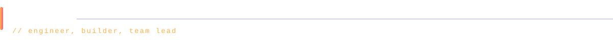

<table width="100%">
<tr>
<td width="52%" valign="middle">

Final-year **Computer Science and AI** student at **Fayoum University** (B.Sc., May 2027), building ML and NLP systems end to end.

- Led a 5-person team to ship **AnomX**, a Kafka - Airflow - XGBoost predictive-maintenance pipeline (**ROC-AUC 0.99**)
- Built news-topic classifiers with Hugging Face and PyTorch, and an **Arabic RAG** question-answering system
- Led a **15+ member** AI team at Google Developer Student Clubs
- Seeking a **remote AI Engineer internship** in NLP and LLM applications

</td>
<td width="48%" align="center" valign="middle">
</td>
</tr>
</table>

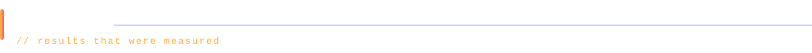

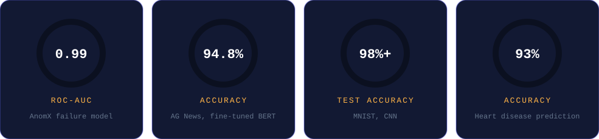

<a href="https://github.com/omarnagy122/Anomx">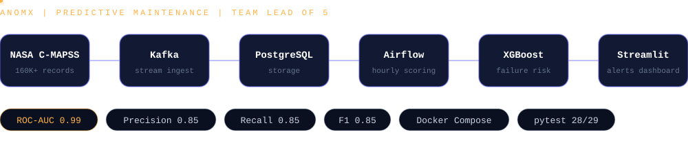</a>

> Simulated real-time Kafka ingestion of 160K+ sensor records, incremental processing with deduplication and context-window features, hourly scoring with Airflow, alerts in a Streamlit dashboard. XGBoost was selected over Random Forest for higher failure-class recall (0.85 vs 0.82). Containerized with Docker Compose.

<table>
<tr>
<td>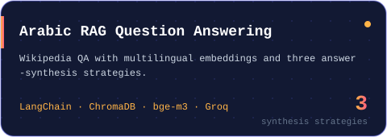</td>
<td><a href="https://github.com/omarnagy122/news-topic-classifier">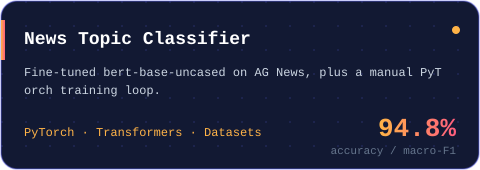</a></td>
</tr>
<tr>
<td><a href="https://github.com/omarnagy122/mnist-cnn">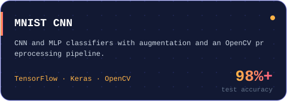</a></td>
<td><a href="https://github.com/omarnagy122/heart-disease-prediction">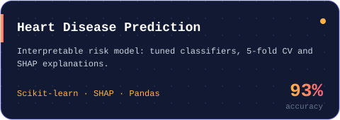</a></td>
</tr>
<tr>
<td><a href="https://github.com/omarnagy122/ai-travel-agent">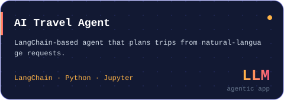</a></td>
<td><a href="https://github.com/omarnagy122/pneumonia-detection-cnn">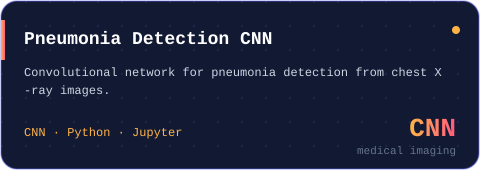</a></td>
</tr>
</table>

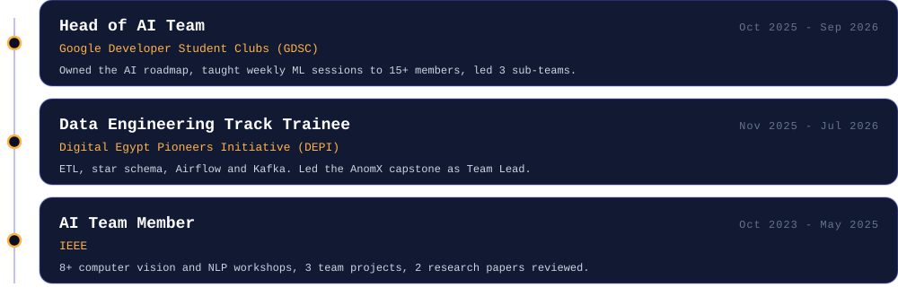

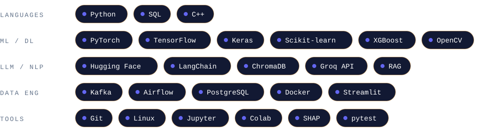

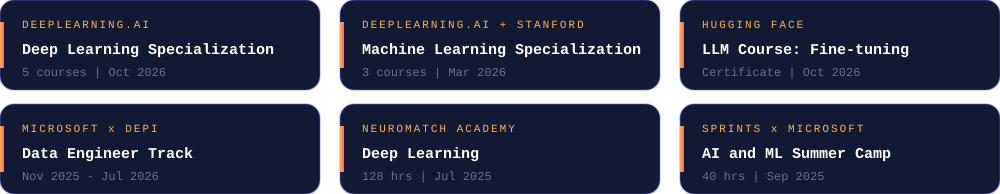

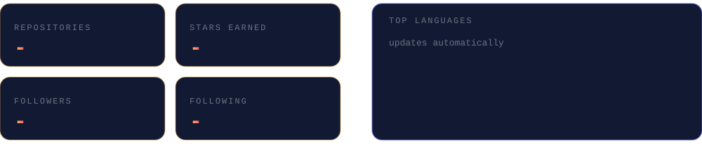

